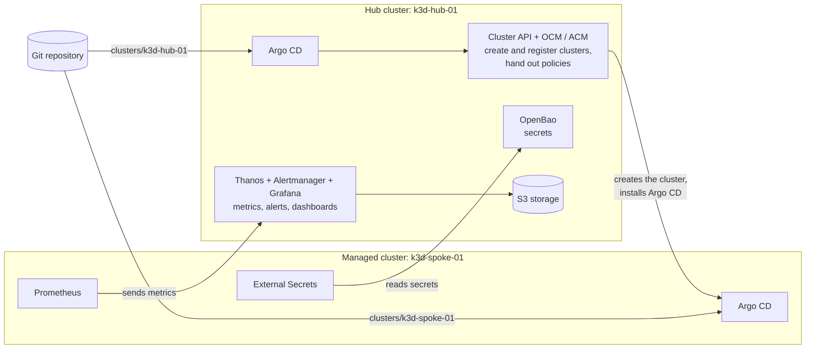
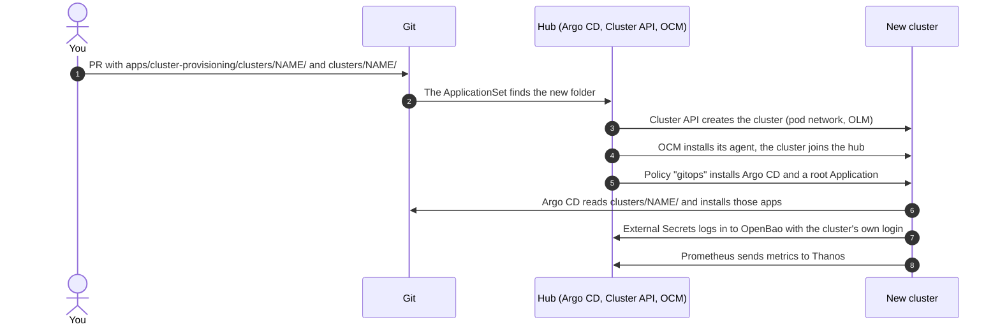
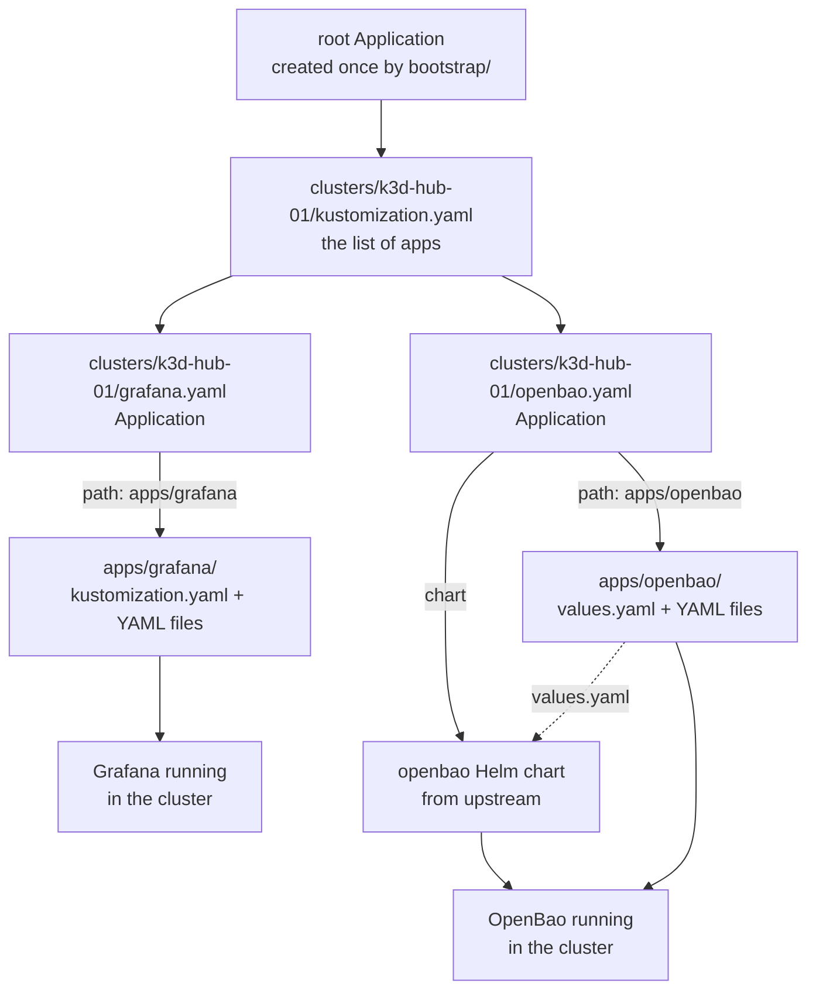

# OpenShift fleet GitOps

A **hub cluster creates, registers and configures other clusters, entirely from Git.** Every
cluster runs its own Argo CD and installs exactly the apps listed for it in this repository.

The lab runs on k3d (Kubernetes in Docker) and uses the open-source upstreams of the OpenShift
stack, so the same design carries over to OpenShift with Red Hat Advanced Cluster Management (ACM):

| In this lab | On OpenShift |
|---|---|
| Open Cluster Management (OCM) | Red Hat Advanced Cluster Management (ACM) |
| Cluster API (Docker provider) | ACM cluster provisioning with Hive (vSphere, bare metal, ...) |
| Argo CD (argocd-operator) | OpenShift GitOps |
| OLM + community operators | OLM + OperatorHub |
| Gateway API on Istio (Sail operator) | Gateway API / Routes (OpenShift ingress) |
| Prometheus + Thanos + Alertmanager + Grafana | ACM Observability |
| OpenBao + External Secrets Operator | Vault + External Secrets Operator |

## The big picture



1. **The hub** is installed once (`bootstrap/`). From then on, its Argo CD installs everything in
   `clusters/k3d-hub-01/`.
2. **A new cluster is a folder in Git.** The hub creates it, registers it and, through a policy,
   gives it its own Argo CD.
3. **Each cluster manages itself.** Its Argo CD installs what is listed in `clusters/<cluster>/`.
4. **Shared services live on the hub:** secrets, metrics, alerts and dashboards for the fleet.

## How a new cluster is born



Nothing on the hub is changed by hand: even the cluster's own login in OpenBao is created from the
same folder (`vault/`).

## Repository layout

The repository has two halves: **what** gets installed (`apps/`) and **where** (`clusters/`).

```
apps/                        WHAT: one folder per app, with everything that belongs to it
  grafana/                     operator + instance + data sources + dashboard + route
  openbao/                     values.yaml for the Helm chart + the app's own YAML
  prometheus/k3d-spoke-01/     a version for one cluster (only when clusters differ)
  cluster-provisioning/
    clusters/k3d-spoke-01/     how one managed cluster is created and registered

clusters/                    WHERE: one folder per cluster
  k3d-hub-01/
    kustomization.yaml         the list of apps on this cluster
    grafana.yaml               one Argo CD Application per app, pointing at apps/grafana/
  k3d-spoke-01/

bootstrap/                   one-time installation of the hub
```

**The rule:**

1. **One app = one folder in `apps/`** with everything that belongs to it: operator, instance,
   routes, certificates and configuration.
2. **One app = one Application file in `clusters/<cluster>/`**, listed in that folder's
   `kustomization.yaml`. A cluster runs exactly the apps listed there.
3. **Different configuration per cluster?** Then the app folder gets one subfolder per cluster
   (`apps/<app>/<cluster>/`). Otherwise the clusters share it.

There are no patches, overlays or base layers: what you see in a file is what gets applied.

## How app of apps works

Argo CD needs exactly one Application created by hand: **root**. Everything else follows from Git.



**Order between apps.** Each Application has a `sync-wave`. Argo CD installs the lowest wave first
and waits until it is healthy: OLM (`-10`), Argo CD (`-5`), cert-manager (`-3`), ingress (`-2`),
then the rest.

**Order inside an app.** The files have waves too: namespace and operator first (`-1`), then the
instance (`0`), then what needs the running instance (`1`).

### One app, start to finish

Every app follows the same pattern. `apps/grafana/`:

| File | What it is | Wave |
|---|---|---|
| `namespace.yaml` | The namespace `grafana` | `-1` |
| `subscription.yaml` | The operator, installed by OLM | `-1` |
| `grafana.yaml` | The Grafana instance the operator runs | `0` |
| `datasources.yaml`, `dashboard-fleet.yaml` | Its configuration | `0` |
| `httproute.yaml` | `https://grafana.apps.hub...` through the cluster Gateway | `0` |
| `kustomization.yaml` | The list of the files above | |

`clusters/k3d-hub-01/grafana.yaml` is the Application that installs it (shortened):

```yaml
apiVersion: argoproj.io/v1alpha1
kind: Application
metadata:
  name: grafana
  namespace: openshift-gitops
  annotations:
    argocd.argoproj.io/sync-wave: "5"      # after the apps it needs
spec:
  project: default
  source:
    repoURL: https://github.com/infrasam/openshift-app-of-apps-kustomize.git
    targetRevision: main
    path: apps/grafana                     # the app's folder
  destination:
    server: https://kubernetes.default.svc
    namespace: grafana
  syncPolicy:
    automated:
      prune: false
      selfHeal: true                       # changes made by hand are reverted
    syncOptions:
      - ServerSideApply=true
      - SkipDryRunOnMissingResource=true   # the instance waits until the operator is installed
    retry:
      limit: 10
```

## Adding a new app

1. **Configuration:** create `apps/<app>/` with the YAML files and a `kustomization.yaml` that
   lists them. For an operator, put its `Subscription` (wave `-1`) in the same folder. For a Helm
   chart, put its settings in `apps/<app>/values.yaml` (example: `apps/object-storage/`).
2. **Application:** copy `clusters/k3d-hub-01/grafana.yaml` (plain YAML) or
   `clusters/k3d-hub-01/object-storage.yaml` (Helm chart) to `clusters/<cluster>/<app>.yaml` and
   change the name, path, namespace and wave.
3. **Turn it on:** add `<app>.yaml` to `clusters/<cluster>/kustomization.yaml`.
4. **Check, then open a pull request:** `kubectl kustomize apps/<app>` and
   `kubectl kustomize clusters/<cluster>` must render. CI validates every file.

**The same app on another cluster:** add an Application file in that cluster's folder.
**A new managed cluster:** copy `apps/cluster-provisioning/clusters/k3d-spoke-01/` and
`clusters/k3d-spoke-01/`, and replace the name and addresses.

**Switching an app off:** put `#` in front of its line in `clusters/<cluster>/kustomization.yaml`;
the files stay in the repository. Argo CD then deletes the Application but not what it installed,
so remove that by hand. Logs (`loki`, `opentelemetry-collector`) and vulnerability scanning
(`trivy-operator`) are off this way because the lab lacks RAM.

## What runs where

| App | Hub | Spoke | What it does |
|---|:-:|:-:|---|
| `olm` | ✓ | ✓ ¹ | Installs operators from `Subscription` objects |
| `argocd` | ✓ | ✓ ² | Installs the cluster's apps from Git |
| `cert-manager` | ✓ | ✓ | Certificates, signed by the lab CA |
| `ingress` | ✓ | | Gateway API + Istio: `https://*.apps.hub.172.19.0.3.nip.io` |
| `external-secrets` | ✓ | ✓ | Turns secrets in OpenBao into Kubernetes Secrets |
| `openbao` | ✓ | | Secret store for the whole fleet |
| `vault-config-operator` | ✓ | | Creates each managed cluster's login in OpenBao |
| `ocm` | ✓ | | Registers managed clusters, hands out policies |
| `capi` | ✓ | | Creates managed clusters |
| `policies` | ✓ | | What every managed cluster gets (Argo CD + root Application) |
| `cluster-provisioning` | ✓ | | One folder per managed cluster |
| `object-storage` | ✓ | | S3 for metrics |
| `thanos` | ✓ | | Metrics from every cluster; alert rules in `apps/thanos/rules/` |
| `alertmanager` | ✓ | | Groups the alerts and sends them on |
| `grafana` | ✓ | | Dashboards, for example *Fleet overview* |
| `prometheus` | | ✓ | Collects the cluster's metrics and sends them to Thanos |

¹ installed when the cluster is created &nbsp; ² installed by the hub's `gitops` policy

## Running the lab

**Requirements:** Docker, `k3d`, `kubectl`, `helm`, `yq`, `git`, about 12 GB of free RAM, and
raised inotify limits (`fs.inotify.max_user_instances = 512`,
`fs.inotify.max_user_watches = 524288`).

```bash
# 1. Create the hub: k3d cluster, OLM, Argo CD and the root Application
bootstrap/bootstrap.sh k3d-hub-01

# 2. OpenBao's unseal key, once per hub and never in Git. OpenBao then configures itself.
umask 077 && openssl rand -out ~/openbao-unseal.key 32
kubectl -n openbao create secret generic openbao-unseal-key --from-file=unseal.key=$HOME/openbao-unseal.key

# 3. Trust the lab CA (import ~/lab-root-ca.crt in the browser too)
kubectl -n operators get secret lab-root-ca -o jsonpath='{.data.ca\.crt}' | base64 -d > ~/lab-root-ca.crt
sudo cp ~/lab-root-ca.crt /usr/local/share/ca-certificates/ && sudo update-ca-certificates
```

The hub then creates `k3d-spoke-01` by itself; `kubectl get managedclusters` shows it joining.

| UI | Address | User |
|---|---|---|
| Argo CD | <https://argocd.apps.hub.172.19.0.3.nip.io> | `admin` |
| Grafana | <https://grafana.apps.hub.172.19.0.3.nip.io> | `admin` |
| OpenBao | <https://openbao.apps.hub.172.19.0.3.nip.io> | token (method *Token*) |

```bash
# Argo CD password
kubectl -n openshift-gitops get secret argocd-cluster -o jsonpath='{.data.admin\.password}' | base64 -d; echo
# Grafana password
kubectl -n grafana get secret grafana-admin-credentials -o jsonpath='{.data.GF_SECURITY_ADMIN_PASSWORD}' | base64 -d; echo
# OpenBao admin token, valid for one hour
kubectl -n openbao create token openbao-admin | jq -Rc '{role: "admin", jwt: .}' \
  | curl -s -X POST --data @- https://openbao.apps.hub.172.19.0.3.nip.io/v1/auth/kubernetes/login \
  | jq -r .auth.client_token
```

**Stop and start the lab:** `docker stop` and `docker start` the containers
`k3d-hub-01-server-0`, `k3d-hub-01-serverlb`, `k3d-spoke-01-lb` and
`k3d-spoke-01-control-plane-*`.

## Safety rails

- **Clusters are never deleted by Git by accident:** `Cluster` and `ManagedCluster` carry
  `Prune=false,Delete=false`, and removing an Application never deletes what it installed.
- **The root Application is fenced:** its project may only create Applications.
- **No secrets in Git:** passwords and keys live in OpenBao and reach the clusters through
  External Secrets.
- **Pinned versions everywhere**, so a rebuilt cluster is identical to the old one.
- **Every change goes through a pull request**, validated by CI.

## Limitations

This is a lab, not a production installation: every component runs as a single instance, there
are no backups yet, alerts are not sent anywhere, logins are local admin accounts, and the
clusters are vanilla Kubernetes rather than OpenShift. The structure and the patterns are the
parts meant to be reused.
